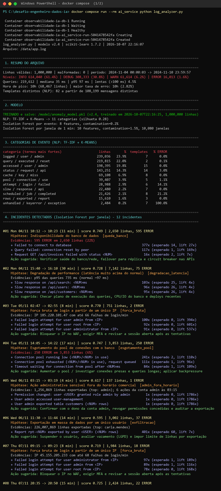
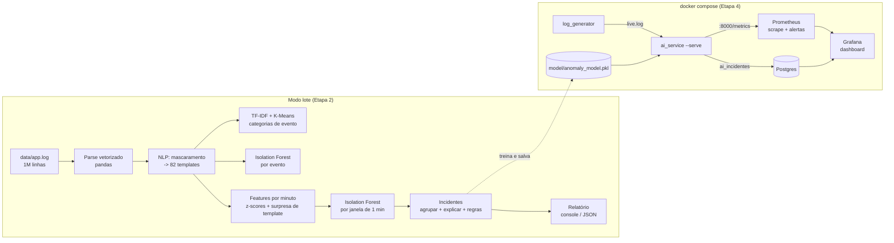
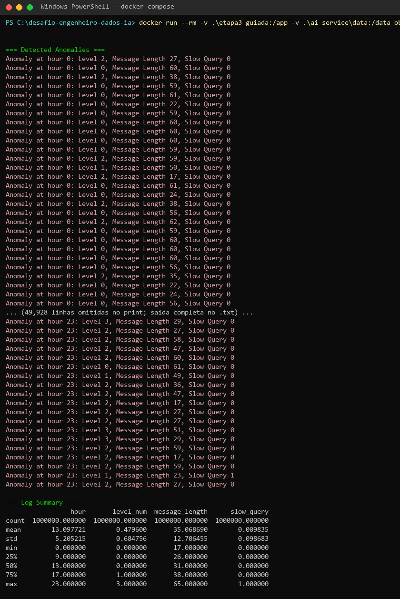
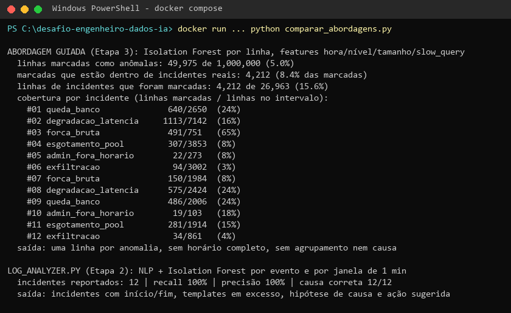
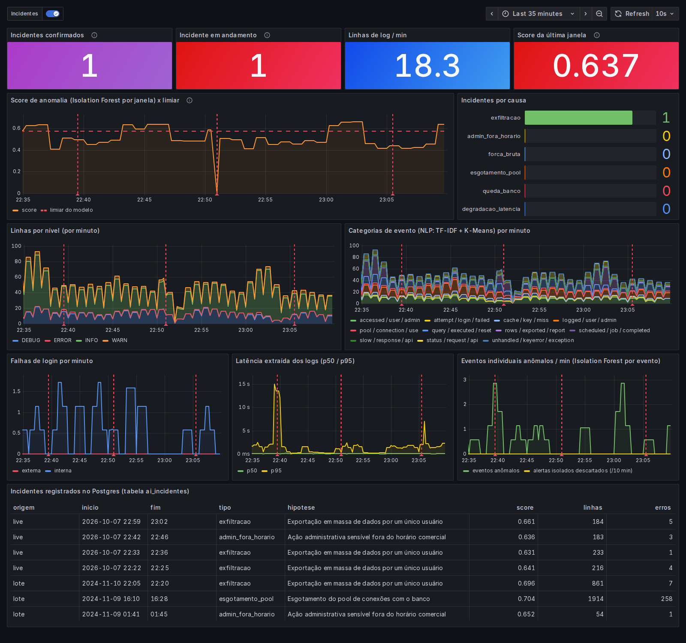
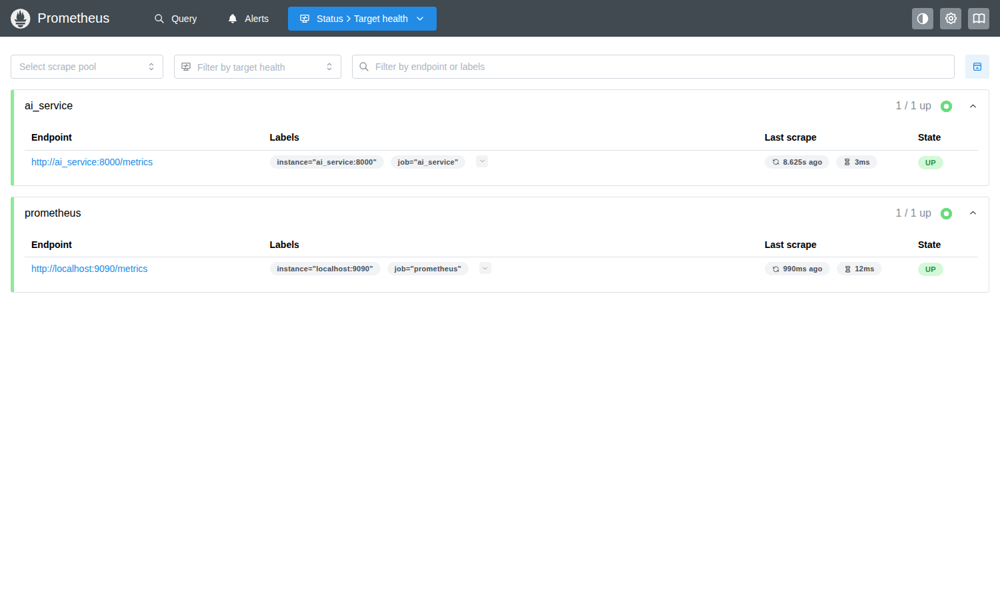
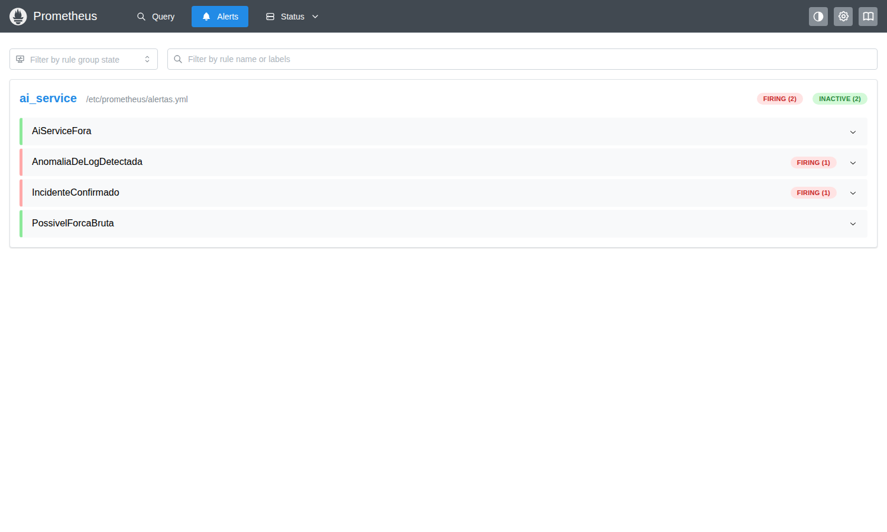
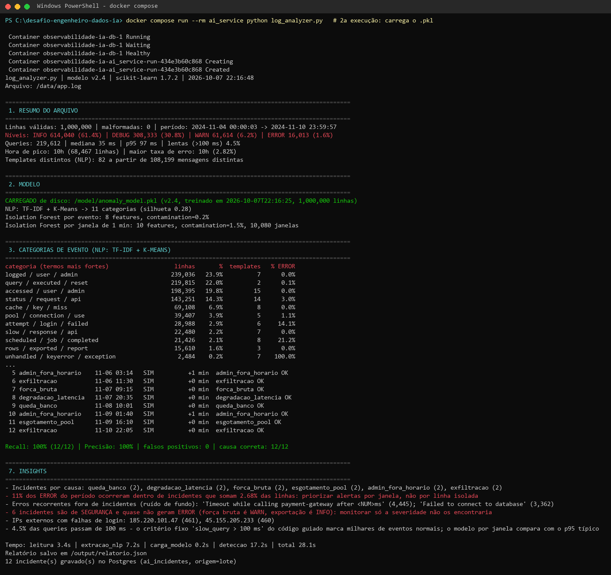

# Análise de Logs com IA: Observabilidade + Isolation Forest + NLP

**Desafio Final do Bootcamp Engenheiro(a) de Dados IA Expert (XP Educação)**, que fecha a pós-graduação
em Engenharia/Arquitetura de Dados.

Um `log_analyzer.py` lê **1 milhão de linhas de log** e, com aprendizado não supervisionado, entrega
**incidentes explicados** em vez de uma lista de linhas "anômalas". Cada incidente traz início e fim, o que mudou, a
causa provável e uma ação sugerida. O mesmo modelo roda como serviço (`ai_service`) dentro de uma stack Docker com
**Prometheus, Grafana e Postgres** e detecta incidentes em tempo real.

| | Abordagem guiada do enunciado (Etapa 3) | **log_analyzer.py (Etapa 2)** |
|---|---|---|
| Saída | 49.975 linhas "anômalas" (5% fixo), sem horário | **12 incidentes** com início/fim, causa e ação |
| Linhas marcadas que caem em incidentes reais | 8,4% | n/a (detecta por janela) |
| Incidentes reais encontrados | não informa | **12/12 (recall 100%)** |
| Alarmes falsos | não mensurável | **0 (precisão 100%)** |
| Causa identificada corretamente | não | **12/12** |
| Tempo (1M linhas, container) | ~32 s | ~28 s (modelo salvo) / ~35 s (com treino) |

> Os 12 incidentes são reais no sentido de que estão no arquivo, mas foram **plantados** pelo gerador de dados
> sintéticos, que grava um gabarito (`incidentes.json`). É isso que permite medir recall e precisão. Veja
> [Limitações](#decisões-e-limitações).

---

## Entrega

| Pedido no enunciado | Onde está |
|---|---|
| Programa Python `log_analyzer.py` | [ai_service/log_analyzer.py](ai_service/log_analyzer.py) |
| Print da execução | [01_etapa2_log_analyzer_1.png](evidencias/01_etapa2_log_analyzer_1.png) e [_2.png](evidencias/01_etapa2_log_analyzer_2.png) (saída em texto: [etapa2_execucao_treino.txt](evidencias/etapa2_execucao_treino.txt)) |
| Etapa 1: `app.log` de 1 milhão de linhas gerado com IA | [ai_service/gerar_logs.py](ai_service/gerar_logs.py) + [prompt usado](docs/prompt_ia_generativa.md) |
| Etapa 3: código guiado executado | [etapa3_guiada/](etapa3_guiada/) + [print](evidencias/02_etapa3_codigo_guiado.png) |
| Etapa 4 (opcional): modelo no `ai_service` | [docker-compose.yml](docker-compose.yml), [Dockerfile](ai_service/Dockerfile), [prints](#etapa-4-modelo-treinado-no-ai_service-docker--prometheus--grafana) |



---

## Arquitetura



---

## Etapa 1: dados de log gerados com IA

Um chat não devolve 1 milhão de linhas (cerca de 60 MB). A IA generativa (Claude) escreveu o **gerador**, a partir do
[prompt documentado](docs/prompt_ia_generativa.md), seguindo a ideia de *dados sintéticos que preservam padrões
reais* do Módulo 3.

- **Formato do enunciado**: `2024-11-08 10:01:20 ERROR Failed to connect to database`, com as mesmas mensagens dos
  exemplos, para que o código guiado também rode.
- **Volume**: 1.000.000 linhas, 7 dias, sazonalidade diária e fim de semana mais calmo.
  INFO 61,4% · DEBUG 30,8% · WARN 6,2% · ERROR 1,6%.
- **Ruído de fundo**: há cerca de 15 mil ERROR "normais" espalhados na semana, então ter um erro não significa ter um incidente.
- **12 incidentes plantados** (gabarito em [incidentes.json](ai_service/data/incidentes.json)):

| Tipo | Quando | Como aparece no log |
|---|---|---|
| `queda_banco` | seg 10:12 · sex 10:01 | rajada de `Failed to connect to database`, `connection reset`, HTTP 500 |
| `degradacao_latencia` | seg 15:40 · qui 20:35 | queries ~10x mais lentas, `Slow response ... 2500-9000ms` |
| `forca_bruta` | ter 02:47 · qui 09:15 | ~60 `Failed login` por minuto de um IP externo, terminando em login de admin |
| `esgotamento_pool` | ter 14:05 · sáb 16:10 | `pool running low` -> `pool exhausted` -> timeouts de 30 s |
| `admin_fora_horario` | qua 03:14 · sáb 01:40 | poucas linhas: concede role admin, desliga auditoria, exporta tabela inteira |
| `exfiltracao` | qua 11:30 · dom 22:05 | um usuário exporta ~25 relatórios/min de 400-900 mil linhas, **só INFO** |

Metade dos incidentes é de **segurança** e quase não gera ERROR. Monitorar só a severidade não os encontra.

---

## Etapa 2: o `log_analyzer.py`

Três técnicas de IA combinadas, todas não supervisionadas:

**1. NLP: de 108 mil mensagens distintas para 82 templates.** Números, IPs e nomes de usuário viram marcadores
(`User <USER> logged in`, `Query executed in <NUM>ms`). A conta `admin` é preservada de propósito. Os templates
alimentam **TF-IDF + K-Means** (k escolhido pelo coeficiente de silhueta), que agrupa o log em 11 categorias de
evento. As categorias também viram métrica no Grafana.

**2. Isolation Forest por evento** (8 features: hora, fora do horário, severidade, latência, raridade do template,
conta privilegiada fora do horário, IP externo, linhas exportadas). Aponta linhas individualmente raras, como
`User admin exported table customers (1250000 rows)` às 03:17.

**3. Isolation Forest por janela de 1 minuto**, o detector principal. Cada um dos 10.080 minutos vira um vetor de
10 features construídas para não confundir "madrugada calma" com "anomalia":

| Feature | Por quê |
|---|---|
| `razao_volume` | volume do minuto ÷ mediana daquela hora (dia útil/fim de semana) |
| `z_erros`, `z_warns` | z-score de Poisson contra o esperado para o volume: 1 erro em 10 linhas de madrugada não é incidente |
| `surpresa_template` | maior `-log10 P(X ≥ n)` entre os templates do minuto, com X ~ Poisson(frequência × volume): **liga o NLP à detecção**, porque qualquer rajada de um tipo de mensagem aparece aqui |
| `log_queries_lentas`, `log_respostas_lentas` | queries > 300 ms e `Slow response` |
| `log_falhas_mesmo_ip` | máximo de falhas de login de um único IP |
| `log_rows_exportadas` | volume exportado no minuto |
| `eventos_raros`, `privilegiadas_fora_horario` | templates com frequência < 0,01% e ações de admin fora do horário |

**Do minuto anômalo ao incidente explicado.** Minutos anômalos próximos são agrupados. Cada grupo é explicado pelos
**templates em excesso**, os que mais surpreendem estatisticamente em relação ao esperado. A **hipótese de causa**
vem de regras determinísticas aplicadas ao template mais surpreendente. O modelo probabilístico detecta e as regras
explicam, a combinação recomendada no Cap. 7 (Governança e Segurança Inteligentes) para reduzir falsos positivos.
Um alerta isolado de 1 minuto sem nenhum template em excesso é descartado como ruído (10 descartes na semana).

Exemplo real da saída:

```
#03 Tue 05/11 02:47 -> 02:55 (8 min) | score 0.770 | 751 linhas, 2 ERROR
    Hipótese: Força bruta de login a partir de um único IP  [forca_bruta]
    Evidências: IP 185.220.101.47 com até 66 falhas de login/min
    + Failed login attempt for user admin from <IP>                    100x (esperado 0, lift 394x)
    + Failed login attempt for user root from <IP>                      92x (esperado 0, lift 601x)
    + Failed login attempt for user administrator from <IP>             91x (esperado 0, lift 537x)
    Ação sugerida: Bloquear o IP no WAF, exigir MFA e revisar a sessão aberta após as tentativas
```

**Seções do relatório**: resumo do arquivo · modelo (treinado ou carregado) · categorias NLP · incidentes ·
eventos individuais mais anômalos · avaliação contra o gabarito · insights. Também grava
[relatorio.json](evidencias/relatorio_etapa2.json) e, se houver `DATABASE_URL`, a tabela `ai_incidentes` no Postgres.

**Avaliação contra o gabarito:**

| # | Tipo real | Início | Detectado | Atraso | Causa prevista |
|---|---|---|---|---|---|
| 1 | queda_banco | seg 10:12 | sim | 0 min | queda_banco ✔ |
| 2 | degradacao_latencia | seg 15:40 | sim | 0 min | degradacao_latencia ✔ |
| 3 | forca_bruta | ter 02:47 | sim | 0 min | forca_bruta ✔ |
| 4 | esgotamento_pool | ter 14:05 | sim | 0 min | esgotamento_pool ✔ |
| 5 | admin_fora_horario | qua 03:14 | sim | +1 min | admin_fora_horario ✔ |
| 6 | exfiltracao | qua 11:30 | sim | 0 min | exfiltracao ✔ |
| 7 | forca_bruta | qui 09:15 | sim | 0 min | forca_bruta ✔ |
| 8 | degradacao_latencia | qui 20:35 | sim | 0 min | degradacao_latencia ✔ |
| 9 | queda_banco | sex 10:01 | sim | 0 min | queda_banco ✔ |
| 10 | admin_fora_horario | sáb 01:40 | sim | +1 min | admin_fora_horario ✔ |
| 11 | esgotamento_pool | sáb 16:10 | sim | 0 min | esgotamento_pool ✔ |
| 12 | exfiltracao | dom 22:05 | sim | 0 min | exfiltracao ✔ |

**Recall 100% · precisão 100% · causa correta 12/12.**

---

## Etapa 3: código guiado e comparação

O código do enunciado foi executado sem alterações de lógica ([log_analyzer_guiado.py](etapa3_guiada/log_analyzer_guiado.py),
só o caminho do log mudou). Ele marca **49.975 linhas** (o `contamination=0.05` força 5%) e imprime uma linha por
anomalia, como `Anomaly at hour 10: Level 1, Message Length 23, Slow Query 1`, sem data nem agrupamento.



[comparar_abordagens.py](etapa3_guiada/comparar_abordagens.py) reproduz o modelo guiado guardando o timestamp de cada
linha e cruza com o gabarito: só **8,4%** das linhas marcadas estão em intervalos de incidente, e a cobertura das
exportações em massa é de 3-4%. As features (hora, nível, tamanho da mensagem, query > 100 ms) não capturam
contexto, porque 4,5% de todas as queries normais passam de 100 ms.



---

## Etapa 4: modelo treinado no `ai_service` (Docker + Prometheus + Grafana)

```bash
docker compose up -d --build
```

Na primeira subida, o `ai_service` gera o `app.log` se ele não existir, treina o modelo e o salva em
`model/anomaly_model.pkl`. A partir daí ele só **carrega** o modelo (0,2 s em vez de 7,5 s de treino). O
`log_generator` escreve logs ao vivo e injeta um incidente aleatório a cada 8 minutos. O `ai_service` acompanha o
arquivo, pontua cada minuto com o modelo salvo e expõe as métricas.

| Serviço | Endereço |
|---|---|
| Grafana (dashboard provisionado, acesso anônimo) | http://localhost:3001 (admin/admin para editar) |
| Prometheus (targets, alertas, PromQL) | http://localhost:9090 |
| Métricas do ai_service | http://localhost:8000/metrics |

**Correções em relação ao material da Etapa 4:**

| Problema no material | Correção |
|---|---|
| `COPY model /app/model` no Dockerfile, mas o código lê `/model/anomaly_model.pkl` | modelo só por volume em `/model` |
| `data_volume:/data` é um volume nomeado vazio: o `app.log` nunca chega ao container | bind mount `./ai_service/data:/data` |
| `python:3.9-slim` (fim de suporte) e imagens sem versão | `python:3.12-slim`, `prom/prometheus:v3.5.0`, `grafana/grafana:12.1.0`, `postgres:17-alpine` |
| modelo carregado sem checar compatibilidade | versão do modelo + versão do scikit-learn gravadas no `.pkl`; retreina se divergir |
| Prometheus sem nada para coletar do `ai_service` | `prometheus_client` exposto em `:8000`, scrape configurado, regras de alerta |

**Métricas exportadas** (os 4 tipos do Prometheus vistos no Cap. 10):

| Métrica | Tipo | O que mede |
|---|---|---|
| `ai_log_lines_total{level}` | counter | linhas processadas por nível |
| `ai_log_lines_by_category_total{category}` | counter | linhas por categoria NLP |
| `ai_log_failed_logins_total{origem}` | counter | falhas de login, IP interno x externo |
| `ai_log_event_anomalies_total` | counter | eventos anômalos (IF por evento) |
| `ai_log_incidents_total{tipo}` | counter | incidentes confirmados por causa |
| `ai_log_window_anomaly_score` / `_threshold` | gauge | score da última janela e limiar do modelo |
| `ai_log_window_anomalous`, `ai_log_incident_open` | gauge | estado atual (0/1) |
| `ai_log_latency_ms` | histogram | latência extraída das mensagens (p50/p95 com `histogram_quantile`) |
| `ai_model` | info | versão e data de treino do modelo carregado |

**Detecção ao vivo.** O `ai_service` usa o mesmo modelo treinado no lote, sem retreinar, para pontuar cada minuto
que o `log_generator` escreve. Trecho real da primeira rodada, em que 3 incidentes foram injetados e 3 confirmados
com a causa certa ([log completo](evidencias/etapa4_ai_service_live_rodada1.txt)):

```
[serve] modelo carregado de /model/anomaly_model.pkl (treinado em 2026-10-07T22:16:25)
[serve] 22:21 linhas=  59 score=0.442 normal
[serve] 22:22 linhas=  77 score=0.626 ANÔMALO
[serve] 22:23 linhas=  77 score=0.641 ANÔMALO
[serve] 22:24 linhas=  62 score=0.583 ANÔMALO
[serve] INCIDENTE 22:22-22:25 exfiltracao: Exportação em massa de dados por um único usuário
...
[serve] 22:42 linhas=  37 score=0.630 ANÔMALO
...
[serve] INCIDENTE 22:42-22:46 admin_fora_horario: Ação administrativa sensível fora do horário comercial
```

Um incidente só é encerrado depois de 3 minutos normais seguidos. Por isso o gerador espaça os incidentes em 8
minutos. Os contadores `ai_log_incidents_total{tipo}` nascem em zero para todos os tipos: sem isso, o primeiro
incidente de cada tipo cria a série já valendo 1, e `increase()` não o enxerga.

**Alertas** ([prometheus/alertas.yml](prometheus/alertas.yml)): `AiServiceFora`, `AnomaliaDeLogDetectada`,
`IncidenteConfirmado` e `PossivelForcaBruta`.



| Prometheus: targets | Prometheus: alertas |
|---|---|
|  |  |

As telas acima foram capturadas na segunda rodada ao vivo ([log](evidencias/etapa4_ai_service_live_rodada2.txt)),
durante um incidente `admin_fora_horario` em andamento e logo depois de uma exfiltração confirmada. A tabela
do Postgres reúne os incidentes do lote (2024) e os ao vivo (2026). Mais telas:
[PromQL](evidencias/08_prometheus_promql.png) · [/metrics](evidencias/09_ai_service_metrics.png) ·
[docker compose ps](evidencias/10_docker_compose_ps.png).

Persistência do modelo: a 2ª execução carrega o `.pkl` em vez de treinar.



---

## Como executar

Pré-requisito: Docker. Python local é opcional; o analisador roda no container.

```bash
git clone https://github.com/Rafael-Carrasqueira/desafio-engenheiro-dados-ia.git
cd desafio-engenheiro-dados-ia

# Etapa 1: gera data/app.log (1M linhas) + data/incidentes.json
docker compose run --rm ai_service python gerar_logs.py

# Etapa 2: análise completa (treina e salva o modelo na 1a vez)
docker compose run --rm ai_service python log_analyzer.py
docker compose run --rm ai_service python log_analyzer.py --retrain   # força novo treino

# Etapa 4: stack de observabilidade com detecção ao vivo
docker compose up -d --build
docker compose logs -f ai_service

# Prints a partir das saídas (Pillow) e telas (Playwright)
python tools/renderizar_prints.py evidencias/etapa2_execucao_treino.txt evidencias/01_etapa2_log_analyzer.png "docker compose run --rm ai_service python log_analyzer.py"
docker run --rm --network observabilidade-ia_backend -v "$PWD/evidencias:/out" -v "$PWD/tools:/tools" \
  mcr.microsoft.com/playwright/python:v1.55.0-noble sh -c "pip install -q playwright==1.55.0 && python /tools/capturar_telas.py"
```

Rodando sem Docker: `pip install -r ai_service/requirements.txt`, depois `python ai_service/gerar_logs.py` e
`python ai_service/log_analyzer.py`. Os caminhos padrão são `ai_service/data`, `ai_service/model` e
`ai_service/output`, ajustáveis por `LOG_FILE`, `MODEL_FILE` e `OUTPUT_DIR`.

---

## Decisões e limitações

- **`contamination` é o hiperparâmetro que mais pesa**: é a fração de minutos que o Isolation Forest assume como
  anômala. Testei cinco valores ([sensibilidade_contamination.txt](evidencias/sensibilidade_contamination.txt)):

  | contamination | incidentes | recall | precisão | alertas isolados descartados |
  |---|---|---|---|---|
  | 0,5% | 9 | 75% | 100% | 0 |
  | 1,0% | 10 | 83% | 100% | 0 |
  | **1,5% (padrão)** | **12** | **100%** | **100%** | 10 |
  | 2,0% | 18 | 100% | 67% | 42 |
  | 3,0% | 28 | 100% | 43% | 113 |

  O valor escolhido equivale a ~150 minutos por semana em alerta. **Este é um ajuste feito com o gabarito à vista**.
  Em produção, o valor sairia do histórico de incidentes ou de um orçamento de alertas que a equipe aceita
  investigar. O parâmetro é configurável via `CONTAMINACAO_JANELA`.
- **Dados sintéticos são mais limpos que a realidade**: os incidentes têm assinaturas nítidas, e o mesmo arquivo é
  usado para treinar e para avaliar (é detecção não supervisionada, sem rótulos no treino, mas sem um conjunto
  separado de teste). Num log real, espere mais alertas a investigar.
- **Por que as features de janela são tão "engenheiradas"**: a primeira versão usava taxa de erro e p95 de
  latência brutos e teve recall de 75% com 58 falsos positivos, quase todos de madrugada. Com ~10 linhas/min, um
  único timeout de 10 s distorce o p95 e um único erro vira 10% de taxa. Os z-scores de Poisson e a surpresa por
  template resolveram isso.
- **O Isolation Forest sozinho tem dificuldade com anomalias em uma única feature**: a exfiltração em horário
  comercial ficava abaixo do limiar até a entrada da `surpresa_template`.
- **O K-Means nos templates não é perfeito**: algumas categorias misturam mensagens que compartilham palavras (uma
  delas junta `Failed login`, `Failed to connect` e `Retrying ... attempt`). As categorias servem para descrever o
  log e para o dashboard; a detecção não depende delas.
- **As regras de causa são explícitas e auditáveis**: um tipo de incidente novo, sem regra, aparece como
  `desconhecido` com os templates em excesso, e um humano decide a partir deles.
- **LLM para resumir incidentes ficou fora de propósito**: não há chamada a API paga. O resumo vem de regras sobre a saída do
  modelo, e um LLM seria um passo opcional em cima de `relatorio.json`.
- **Windows**: o Smart App Control bloqueou as DLLs do scikit-learn no Python local, por isso tudo roda no
  container, que também é o ambiente da Etapa 4.

## Ligação com a teoria do curso

- **Telemetria (Cap. 10)**: modelo pull/scrape do Prometheus, os 4 tipos de métrica (counter, gauge, histogram,
  e info no lugar de summary), labels, PromQL (`rate`, `histogram_quantile`) e Grafana com data source provisionado.
- **Os 3 pilares da observabilidade**: os **logs** viram **métricas** (taxas, latências, scores); o rastreamento
  ficaria para uma evolução com OpenTelemetry.
- **IA generativa aplicada à Engenharia de Dados (Módulo 3)**: dados sintéticos que preservam a distribuição,
  *AI Observability* (detecção de anomalias e resumo inteligente de logs) e AIOps (correlacionar eventos, gerar
  alerta e registrar incidente).
- **Governança e Segurança Inteligentes (Cap. 7)**: aprendizado não supervisionado encontra desvios sem
  assinatura conhecida (força bruta, admin de madrugada, exportação em massa); regras determinísticas
  sobre o modelo probabilístico reduzem falsos positivos; *model governance* (modelo versionado, com data de
  treino e versão da biblioteca registradas e expostas como métrica `ai_model_info`).

## Estrutura

```
├── ai_service/
│   ├── log_analyzer.py        # entrega: análise com IA (lote) e ai_service (--serve)
│   ├── gerar_logs.py          # Etapa 1: 1M linhas + gabarito; modo --live
│   ├── Dockerfile, requirements.txt
│   ├── data/                  # app.log (gerado, fora do git), incidentes.json, live.log
│   ├── model/                 # anomaly_model.pkl (gerado)
│   └── output/                # relatorio.json (gerado)
├── etapa3_guiada/             # código do enunciado + comparação com o gabarito
├── prometheus/                # scrape + regras de alerta
├── grafana/                   # datasources (Prometheus, Postgres) e dashboard provisionados
├── docs/prompt_ia_generativa.md
├── tools/                     # renderizar prints e capturar telas
├── evidencias/                # prints e saídas das execuções
└── docker-compose.yml
```

---

Rafael Carrasqueira · Pós-graduação XP Educação. Também nesta série:
[desafio-arquiteto-dados](https://github.com/Rafael-Carrasqueira/desafio-arquiteto-dados) ·
[desafio-engenheiro-dados](https://github.com/Rafael-Carrasqueira/desafio-engenheiro-dados)
